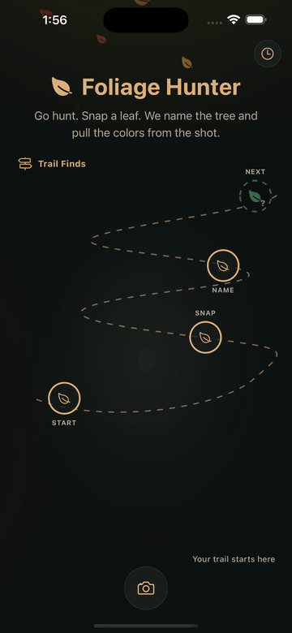
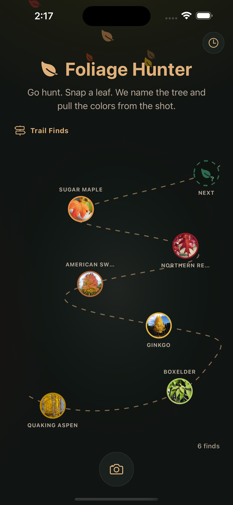
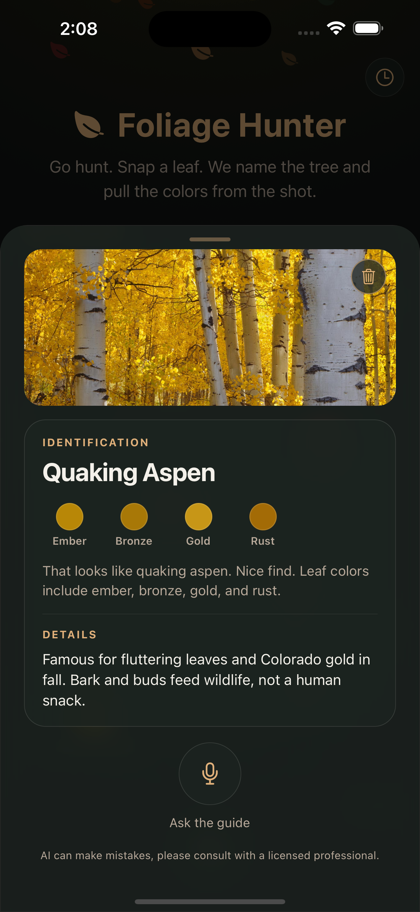
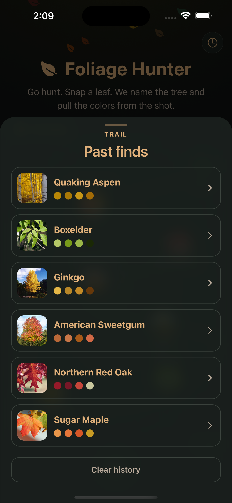
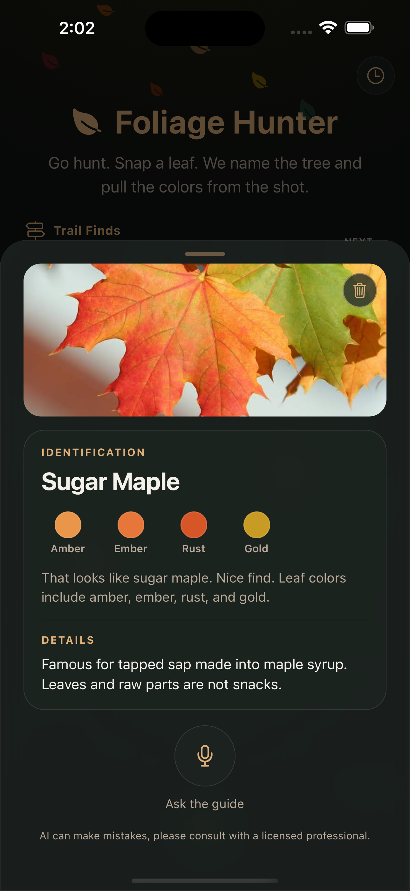
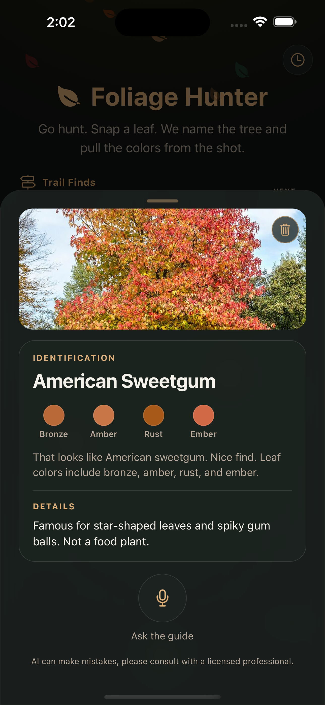
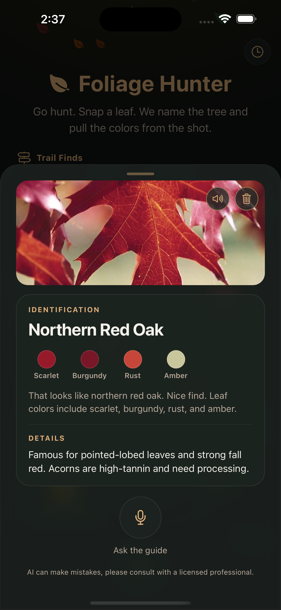
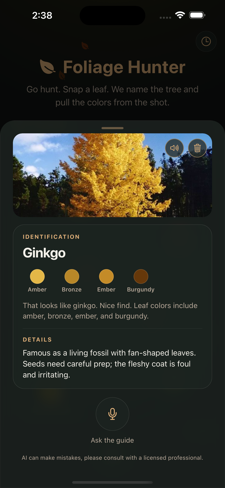
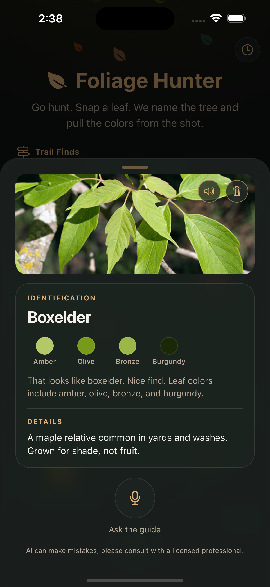

<div align="center">

# Foliage Hunter

</div>

<div align="center">
  <a href="https://dev.to/challenges/hf26"></a>
  <a href="https://huggingface.co/EdyVision/foliage-hunter-gemma3-12b"></a>
  <a href="https://huggingface.co/EdyVision/foliage-hunter-gemma3-12b"></a>
  
  
  
  
  
  
  
  
  
  
  
  
</div>

Foliage Hunter is a pocket leaf guide for Colorado's fall. You walk, you find a leaf, you snap it. A Gemma 3 model fine-tuned on Colorado species names the tree, a guide voice tells you what you are looking at, and the find is pinned to a winding trail of everything you have spotted this season. The screen is meant to be the shortest part of the walk.

<div align="center">
  
</div>

## Why this exists

Built for the [Hacktoberfest Open-Source AI Challenge: Week 1](https://dev.to/challenges/hf26) on DEV (October 5–11, 2026). The week's theme was **Touch Grass**: build something with open-source AI at its core that gets people off the screen and into the world. Fall foliage was literally on the prompt's list of examples, and the Front Range was peaking. Entered under `#hf26challenge` and the **Best Use of Gemma** category.

## Why open models matter here

- **A regional model is only possible with open weights.** No hosted vision API knows the difference between a Gambel oak and a northern red oak on a Colorado trail. With `google/gemma-3-12b-it` as an open base, a 284 MB LoRA adapter trained on about 1,440 iNaturalist photos turns a general VLM into one that gets 85.1% on a held-out set of 18 local species. The adapter and the full experiment log are public on Hugging Face, so anyone can retrain it for their own state.
- **Photos never leave infrastructure we control.** Inference runs on a DGX Spark in a home lab; the phone reaches it over Tailscale. There is no third-party account, no per-image bill, and no location or photo data on someone else's server.
- **Every model is swappable by env var.** The app speaks plain OpenAI-compatible HTTP through LiteLLM. Point `EXPO_PUBLIC_GUIDE_MODEL` at a different alias and nothing in the client changes. The voice is open too: NVIDIA Magpie TTS runs as a GGUF model on the same box, so both models in the loop are open weights. Gemma is the specialist; it names the leaf and nothing else.
- **It degrades gracefully.** Leaf color extraction runs on the phone from the JPEG itself. Without a server URL the app falls back to a built-in demo guide, so the UI and the trail still work with no network at all.

## What the app does

| Trail landing | Identification | Past finds |
| :---: | :---: | :---: |
|  |  |  |

1. **Hunt.** Tap the orb, take a photo or pick one. A leaf wreath spins while the model works and the first sentence of audio is fetched.
2. **Identify.** The card shows the species, a curated set of traits (leaf shape, bark, habitat, fall color, look-alikes) from an 18-species catalog, and the dominant leaf colors pulled from the photo on-device.
3. **Listen.** The guide reads the identification aloud through Magpie TTS, sentence-streamed so speech starts before the whole reply is synthesized.
4. **Ask (planned).** The mic button is the start of a free conversation with the guide about what you are looking at ("is this one poisonous?", "what else turns this red?"). The client already records and posts to `/v1/voice/turn` (`docs/guide-contract.md`), but no server implements that route in this release, so it only answers in the built-in demo guide. The plan is Nemotron ASR for speech in, Gemma for the answer with the current find as context, and Magpie for speech out.
5. **Track.** Every find is pinned to the trail and kept in a local history. Open a past find to replay it or delete it from the photo card.

### Hear the guide

Six real finds from the trail above, with the exact line the guide spoke (identification, leaf colors pulled from the photo, then the curated species note). Clips are Magpie TTS output from the guide server; tap a pill to play.

| Find | Listen | What the guide said |
| :--- | :---: | :--- |
| <br>**Quaking aspen** | <a href="docs/media/audio/quaking-aspen.mp3"></a> | <sub>That looks like quaking aspen. Nice find. Leaf colors include ember, bronze, gold, and rust. Famous for fluttering leaves and Colorado gold in fall. Bark and buds feed wildlife, not a human snack.</sub> |
| <br>**Sugar maple** | <a href="docs/media/audio/sugar-maple.mp3"></a> | <sub>That looks like sugar maple. Nice find. Leaf colors include amber, ember, rust, and gold. Famous for tapped sap made into maple syrup. Leaves and raw parts are not snacks.</sub> |
| <br>**American sweetgum** | <a href="docs/media/audio/american-sweetgum.mp3"></a> | <sub>That looks like American sweetgum. Nice find. Leaf colors include bronze, amber, rust, and ember. Famous for star-shaped leaves and spiky gum balls. Not a food plant.</sub> |
| <br>**Northern red oak** | <a href="docs/media/audio/northern-red-oak.mp3"></a> | <sub>That looks like northern red oak. Nice find. Leaf colors include scarlet, burgundy, rust, and amber. Famous for pointed-lobed leaves and strong fall red. Acorns are high-tannin and need processing.</sub> |
| <br>**Ginkgo** | <a href="docs/media/audio/ginkgo.mp3"></a> | <sub>That looks like ginkgo. Nice find. Leaf colors include amber, bronze, ember, and burgundy. Famous as a living fossil with fan-shaped leaves. Seeds need careful prep; the fleshy coat is foul and irritating.</sub> |
| <br>**Boxelder** | <a href="docs/media/audio/boxelder.mp3"></a> | <sub>That looks like boxelder. Nice find. Leaf colors include amber, olive, bronze, and burgundy. A maple relative common in yards and washes. Grown for shade, not fruit.</sub> |

Inside the app, the same clips are saved per find, so reopening a past find and tapping the speaker replays the guide offline.

### Species catalog

Quaking aspen, narrowleaf cottonwood, Gambel oak, boxelder, Rocky Mountain maple, chokecherry, serviceberry, peachleaf willow, green ash, Siberian elm, silver maple, sugar maple, northern red oak, American sweetgum, ginkgo, ponderosa pine, Douglas-fir, blue spruce. The list is the closed set the LoRA was trained on; `training/configs/colorado_priority_species.json` is the source of truth.

## How it is built

Two open models, each with one job. Nothing in the spoken reply is improvised by a language model; the prose is a curated catalog.

| Job | Model | Runs in |
| :--- | :--- | :--- |
| Photo to species name (closed set of 18) | Gemma 3 12B IT + the Colorado LoRA (`adapters/colorado_v1`) | `guide-server`, transformers + PEFT |
| Every spoken line | Magpie TTS Multilingual 357M + NanoCodec, GGUF | `nemo-speech serve` |
| "That looks like X. Nice find." | no model, a template in `guide-server` | |
| Species notes and leaf colors | no model, `domain/speciesTraits.ts` and the on-device JPEG palette | phone |
| Mic conversation (`/v1/voice/turn`) | planned: Nemotron ASR, Gemma, Magpie; demo guide only in this release | |

```text
  phone (Expo Go)                       home lab
 ┌───────────────────┐   Tailscale    ┌──────────────────────────────────────┐
 │ camera / library  │ ─────────────▶ │ LiteLLM  (alias: gemma-foliage)      │
 │ jpeg palette      │                │   └─▶ guide-server (FastAPI + PEFT)  │
 │ species traits    │ ◀───────────── │        Gemma 3 12B IT + LoRA r=16    │
 │ Magpie playback   │   audio/wav    │ nemo-speech (GGUF)                   │
 │ trail + history   │                │   Magpie TTS 357M                    │
 └───────────────────┘                └──────────────────────────────────────┘
```

**Mobile** (`mobile/`): Expo SDK 57, React Native 0.86, TypeScript, hexagonal layout. `domain/` holds the species catalog and types, `ports/` the interfaces (`GuideClient`, `Speech`, `Camera`, `PaletteReader`, `FindHistory`), `adapters/` the Expo and HTTP implementations, `application/` the use-cases (`identifyLeaf`, `runVoiceTurn`, `recordFind`), and `composition/wire.ts` the single place that reads env vars and assembles everything.

**Training** (`training/`): `build_inat_corpus.py` pulls research-grade iNaturalist observations for the 18 species (80 per species, Colorado place filter). `foliage_lora_job.py` runs PEFT LoRA (r=16, alpha=32, 600 steps, lr 2e-4, answer-token masking on a closed-set prompt) via the Ray Jobs API on a DGX Spark. `foliage_eval_job.py` does generate-and-match on the stratified 20% hold-out: **85.1% (245/288)**. See `docs/fine-tune-policy.md`.

**Serving** (`guide-server/`): a small FastAPI server that loads base + adapter with transformers/PEFT and exposes `/v1/chat/completions` (image parts) and `/v1/vision/turn`. LiteLLM fronts it as `gemma-foliage` so the app never learns a lab IP. See `docs/serving.md` and `docs/guide-contract.md`.

## Run it

```bash
make help
make install
make env-mobile          # copies mobile/.env.example → mobile/.env; set EXPO_PUBLIC_GUIDE_URL
make start               # Expo Go on the same Wi-Fi
make start-ts            # Expo Go over Tailscale (phone on cellular)

make train               # Ray LoRA on Spark
make train-eval          # held-out eval
```

Without `EXPO_PUBLIC_GUIDE_URL` the app uses a local demo guide. With a URL, photo identify tries `/v1/chat/completions` with an image part, then `/v1/vision/turn`.

### Taking it outside

Expo Go on the same Wi-Fi is enough for the simulator and couch testing. To hunt leaves away from home, put the phone and the Mac on the same Tailscale tailnet:

1. Install Tailscale on the phone and connect.
2. Point `EXPO_PUBLIC_GUIDE_URL` at a host the phone can reach over the tailnet (verify in Safari on the phone: `<GUIDE_URL>/v1/models`).
3. `make start-ts` on the Mac. Metro advertises the Mac's `100.x` address, so the QR code works on cellular. Keep the Mac awake (`caffeinate -i`).

Prefer `npx expo install <pkg>` over `npm install` for anything with a native side; Expo Go only ships the native versions pinned by the SDK (`npx expo-doctor` checks).

## Repository layout

```text
foliage-hunter/
  mobile/         Expo Go client (hexagonal ports/adapters)
  guide-server/   FastAPI OpenAI-compatible serve for base + LoRA (Spark)
  training/       iNaturalist corpus builder, Ray LoRA + eval jobs, species config
  docs/           guide API contract, fine-tune policy, serving notes, media
```

## Public artifacts

- Adapter: https://huggingface.co/EdyVision/foliage-hunter-gemma3-12b (`adapters/colorado_v1`)
- Experiments (split manifests, eval results, observation IDs): https://huggingface.co/datasets/EdyVision/foliage-hunter-experiments
- Base model: https://huggingface.co/google/gemma-3-12b-it (Gemma terms apply)

Training images are iNaturalist research-grade observations fetched through the public API. Image bytes are not redistributed; observation IDs and licenses are.

## Attributions

Foliage Hunter is a thin layer on other people's open work. If you build on this repo, please carry these forward.

### Models

**Gemma 3 12B IT** (base model). Weights from [google/gemma-3-12b-it](https://huggingface.co/google/gemma-3-12b-it), used under the [Gemma Terms of Use](https://ai.google.dev/gemma/terms). The LoRA adapter published at `EdyVision/foliage-hunter-gemma3-12b` is a derivative and inherits those terms.

```bibtex
@article{gemma3_2025,
  title   = {Gemma 3 Technical Report},
  author  = {{Gemma Team} and others},
  journal = {arXiv preprint arXiv:2503.19786},
  year    = {2025},
  url     = {https://arxiv.org/abs/2503.19786}
}
```

**Magpie TTS Multilingual 357M** (the guide's voice) and **NanoCodec** (its audio decoder), both from NVIDIA under the [NVIDIA Open Model License](https://www.nvidia.com/en-us/agreements/enterprise-software/nvidia-open-model-license): [nvidia/magpie_tts_multilingual_357m](https://huggingface.co/nvidia/magpie_tts_multilingual_357m), [nvidia/nemo-nano-codec-22khz-1.89kbps-21.5fps](https://huggingface.co/nvidia/nemo-nano-codec-22khz-1.89kbps-21.5fps). The model card points to Koel-TTS as the core method.

```bibtex
@misc{nvidia_magpie_tts_357m,
  title        = {Magpie TTS Multilingual 357M},
  author       = {{NVIDIA}},
  year         = {2025},
  howpublished = {\url{https://huggingface.co/nvidia/magpie_tts_multilingual_357m}},
  note         = {NVIDIA Open Model License}
}

@inproceedings{hussain2025koeltts,
  title     = {Koel-TTS: Enhancing LLM based Speech Generation with Preference Alignment and Classifier Free Guidance},
  author    = {Hussain, Shehzeen and Neekhara, Paarth and Yang, Xuesong and Casanova, Edresson and Ghosh, Subhankar and Desta, Mikyas T. and Fejgin, Roy and Valle, Rafael and Li, Jason},
  booktitle = {Proceedings of the 2025 Conference on Empirical Methods in Natural Language Processing (EMNLP)},
  year      = {2025},
  url       = {https://arxiv.org/abs/2502.05236}
}
```

### Data

**iNaturalist.** Every training and evaluation image is a research-grade observation photo contributed by an iNaturalist user and retrieved through the public API. All 1,440 photos (729 observations) carry Creative Commons licenses: CC BY-NC 1016, CC BY 301, CC0 47, CC BY-NC-ND 38, CC BY-NC-SA 28, CC BY-ND 6, CC BY-SA 4. They were used for private training and evaluation only. Image bytes are not redistributed; the observation IDs, per-photo licenses, and split manifests are in [EdyVision/foliage-hunter-experiments](https://huggingface.co/datasets/EdyVision/foliage-hunter-experiments) so the corpus can be rebuilt and each photographer credited. Thank you to the observers whose photos taught the model what a Colorado leaf looks like.

```bibtex
@misc{inaturalist2026,
  title        = {iNaturalist research-grade observations},
  author       = {{iNaturalist contributors}},
  year         = {2026},
  howpublished = {\url{https://www.inaturalist.org}},
  note         = {Retrieved via \url{https://api.inaturalist.org/v1/observations}, October 2026. Observation IDs listed in EdyVision/foliage-hunter-experiments}
}
```

### Methods and tooling

```bibtex
@inproceedings{hu2022lora,
  title     = {LoRA: Low-Rank Adaptation of Large Language Models},
  author    = {Hu, Edward J. and Shen, Yelong and Wallis, Phillip and Allen-Zhu, Zeyuan and Li, Yuanzhi and Wang, Shean and Wang, Lu and Chen, Weizhu},
  booktitle = {International Conference on Learning Representations (ICLR)},
  year      = {2022},
  url       = {https://arxiv.org/abs/2106.09685}
}

@misc{peft,
  title        = {PEFT: State-of-the-art Parameter-Efficient Fine-Tuning methods},
  author       = {Mangrulkar, Sourab and Gugger, Sylvain and Debut, Lysandre and Belkada, Younes and Paul, Sayak and Bossan, Benjamin},
  year         = {2022},
  howpublished = {\url{https://github.com/huggingface/peft}}
}

@inproceedings{wolf2020transformers,
  title     = {Transformers: State-of-the-Art Natural Language Processing},
  author    = {Wolf, Thomas and Debut, Lysandre and Sanh, Victor and Chaumond, Julien and Delangue, Clement and Moi, Anthony and Cistac, Pierric and Rault, Tim and Louf, R{\'e}mi and Funtowicz, Morgan and Davison, Joe and Shleifer, Sam and von Platen, Patrick and Ma, Clara and Jernite, Yacine and Plu, Julien and Xu, Canwen and Le Scao, Teven and Gugger, Sylvain and Drame, Mariama and Lhoest, Quentin and Rush, Alexander M.},
  booktitle = {Proceedings of the 2020 Conference on Empirical Methods in Natural Language Processing: System Demonstrations},
  year      = {2020},
  url       = {https://arxiv.org/abs/1910.03771}
}

@inproceedings{moritz2018ray,
  title     = {Ray: A Distributed Framework for Emerging AI Applications},
  author    = {Moritz, Philipp and Nishihara, Robert and Wang, Stephanie and Tumanov, Alexey and Liaw, Richard and Liang, Eric and Elibol, Melih and Yang, Zongheng and Paul, William and Jordan, Michael I. and Stoica, Ion},
  booktitle = {13th USENIX Symposium on Operating Systems Design and Implementation (OSDI)},
  year      = {2018},
  url       = {https://arxiv.org/abs/1712.05889}
}
```

Also load-bearing, cited by link: [NeMo-Speech.cpp](https://github.com/NVIDIA/NeMo-Speech.cpp) (GGUF runtime behind `nemo-speech serve`), [LiteLLM](https://github.com/BerriAI/litellm) (OpenAI-compatible gateway), [Expo](https://expo.dev) and [React Native](https://reactnative.dev) (the client), and [Tailscale](https://tailscale.com) (phone-to-lab path).

### Citing this project

```bibtex
@misc{rosado2026foliagehunter,
  title        = {Foliage Hunter: a Colorado-tuned Gemma 3 LoRA leaf guide},
  author       = {Rosado, Eidan},
  year         = {2026},
  howpublished = {\url{https://github.com/EdyVision/foliage-hunter}},
  note         = {Adapter: \url{https://huggingface.co/EdyVision/foliage-hunter-gemma3-12b}; experiments: \url{https://huggingface.co/datasets/EdyVision/foliage-hunter-experiments}}
}
```

## License

MIT. See `LICENSE`.
